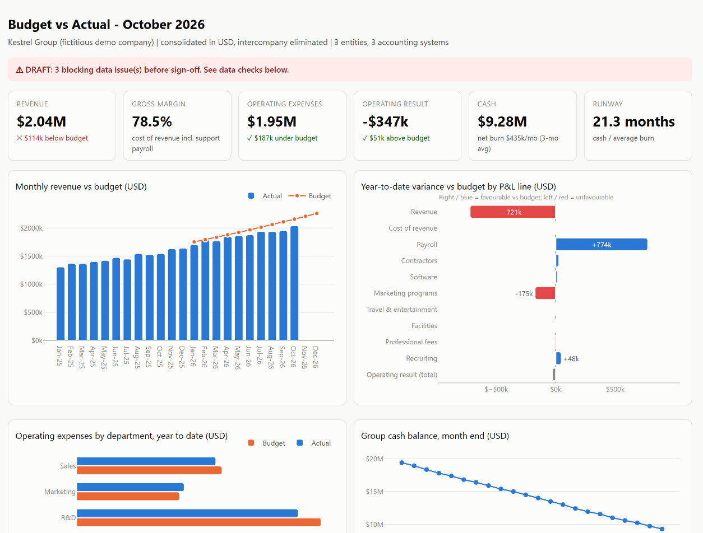

# From messy data to numbers you can trust

**Guilherme Teófilo**, data analyst. I turn messy data into something you can use: clean datasets,
automated reports, data collected from public websites and dashboards that update on their own.
I work in Python, SQL, Excel/VBA and Looker Studio.

- **Data cleaning and ETL:** exports from different systems become one validated dataset, plus a script
  you can run again on the next batch.
- **Automation:** recurring reports and repetitive spreadsheet work handled by Python, SQL or VBA.
- **Web scraping:** structured data from public websites (requests, BeautifulSoup, Selenium), easy to refresh.
- **Dashboards:** in Looker Studio, or as a one-page HTML dashboard that opens from a link, with every
  metric defined.
- **Finance data:** month-end reporting automation, budget vs actual dashboards and one model for ledger,
  budget and actuals.

Most of my 3+ years in data have been in finance (FP&A and controllership), at a multinational financial
services company and at Adapta, a fast-growing AI scale-up. In finance, a total that is off by one cent
gets noticed. That habit goes into every project: I reconcile totals to the source, flag duplicates and
missing rows, and tell you what I found. BSc in Computer Science. Fluent English (EF SET C2).

## Case studies

Cases 01 to 03 run on the same engine and the same **fictitious** dataset: Kestrel Group, a 3-entity SaaS
company whose ledgers come from QuickBooks-, Xero- and DATEV-style exports ([dataset notes](data/README.md)).
Case 04 collects its data from the web, from two sites built for scraping practice.

| Case | What it shows | Result on the demo data |
|---|---|---|
| [**01 · Month-end reporting automation**](cases/01-month-end-reporting-automation/README.md) | 3 accounting-system exports become a validated, consolidated management pack in Excel, with variance commentary drafted from reconciled numbers | From a typical 1.5 to 2 days of manual work to **~5 seconds**; **6 of 6** seeded data issues caught, each with file and line |
| [**02 · Budget vs actual dashboard**](cases/02-budget-vs-actual-dashboard/README.md) | A one-page dashboard a CFO opens from a link, plus BI-ready tables for Looker Studio | FX separated from operational variance; mis-tagged cost flagged instead of reported as a saving |
| [**03 · Finance data foundation**](cases/03-finance-data-foundation/README.md) | The SQL model underneath: account and department mapping, FX, intercompany elimination, plan vs actual | **11 automated tests**, including budget vs actual reconciling to its inputs to the cent |
| [**04 · Price and catalog monitor**](cases/04-price-and-catalog-monitor/README.md) | Web scraping as a recurring system: static pages (requests + BeautifulSoup) and AJAX pages (Selenium), history without duplicates, change detection and a data quality report per run | **1,147 products** from 76 pages in 82 seconds; **28 of 28** seeded changes detected, and **0 false removals** when a page fails to load |



## Mini-cases

Short demos with one job each, in the format clients ask for: the task, the solution, how many records and
how long it took. The scraping ones run on practice sites built for scraping; the exchange rates come from an
official public API. Every number was measured on a real run.

| Mini-case | Task | Records | Time |
|---|---|---|---|
| [**01 · Scrapy spider**](minicases/01-scrapy-quotes/README.md) | From list pages to detail pages, with pipelines that validate and drop duplicates, robots.txt and AutoThrottle | **100 quotes and 50 authors** from 186 items (86 duplicates dropped) | 93 s, 76 requests |
| [**02 · Playwright for JavaScript pages**](minicases/02-playwright-js-pages/README.md) | Infinite scroll read to the end, next to a plain request that sees nothing | **100 of 100 quotes**; the plain request found 0 | 26 s for the scroll |
| [**03 · Crawl coverage report**](minicases/03-coverage-report/README.md) | Every discovered URL ends collected, failed with its reason, or excluded; checkpoint and resume after the process is killed | **1,103 URLs**, every one accounted for; 999 books; both injected failures caught | 17.5 min at 1 request per second, killed and resumed |
| [**04 · ECB exchange rates**](minicases/04-ecb-fx-rates/README.md) | Official API, incremental updates, TARGET holidays, checks for gaps and duplicates, CSV and Excel | **263,715 rates**, 44 currencies, daily since 1999 | 14 s in full, 0.7 s per update |

## Run it yourself

```bash
pip install -e .[dev]
python data/generate.py                        # build the fictitious dataset
python -m findata.report --period 2026-10      # case 01: Excel management pack
python -m findata.dashboard --period 2026-10   # case 02: dashboard + BI tables
python -m pricewatch.demo                      # case 04: live crawl + simulated next day (~2 min, needs Chrome)
pytest                                         # every test, all offline
```

Each mini-case runs from its own folder: the commands are on its page.

Outputs land in [`output/2026-10/`](output/2026-10/) and [`output/pricewatch/`](output/pricewatch/).

**Stack:** Python, SQL (DuckDB, SQLite), pandas, Plotly, Excel (xlsxwriter), requests, BeautifulSoup,
Selenium, Scrapy, Playwright, pytest. The finance engine starts from plain CSV/Excel exports, so it works
with any ERP or accounting system.

## Working together

I take fixed-scope, fixed-price projects and ongoing monthly support. You get a short progress update
every day until delivery, full source code with a one-page guide, and no lock-in. Each case study shows
that kind of deliverable on fictitious data.

---
<sub>All companies, people and figures in this repository are fictitious. Before/after timings: "after" is
measured on the demo data; "before" is an estimate of a typical manual process.</sub>
