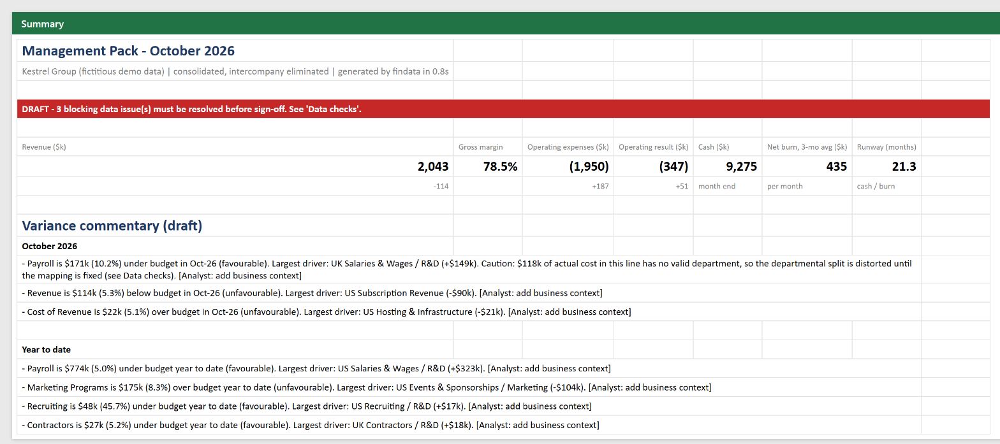
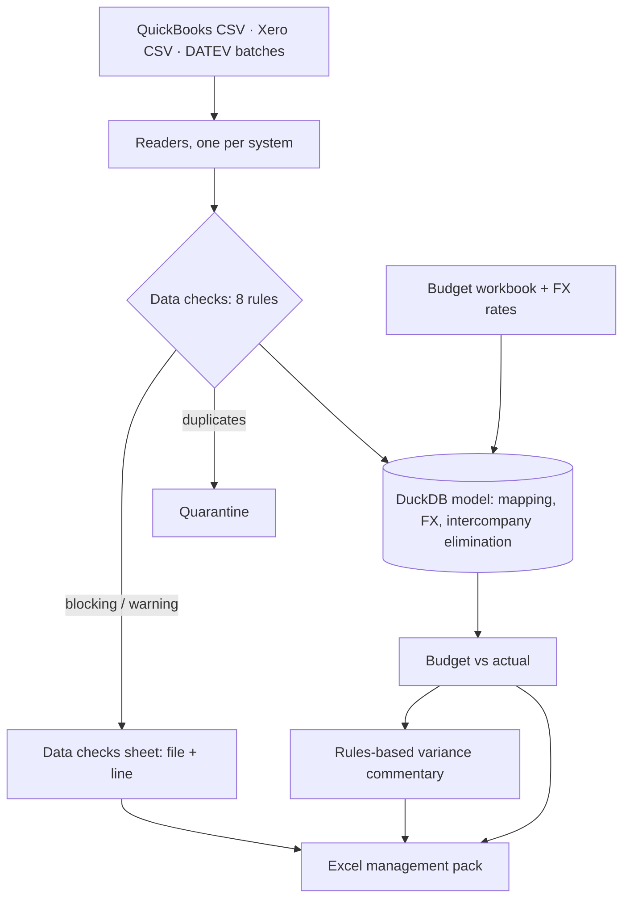
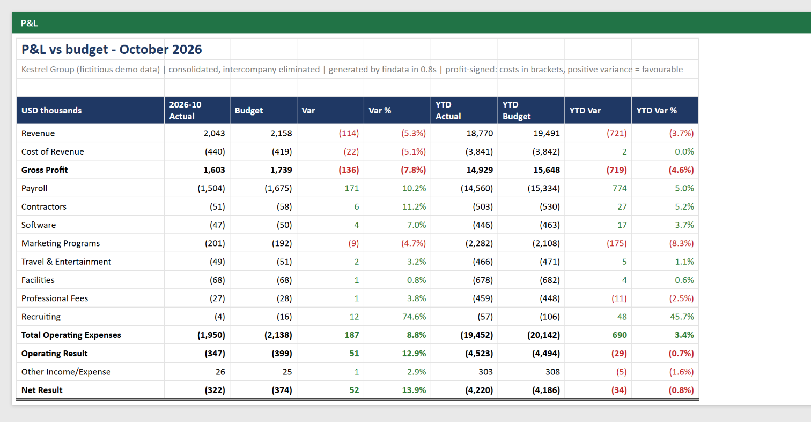
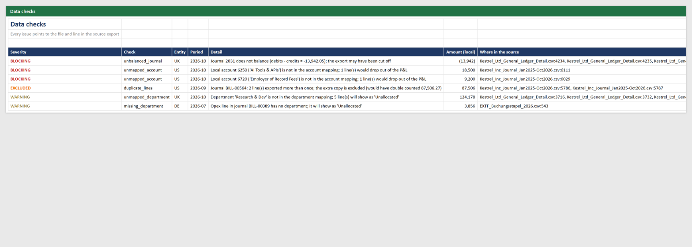

# Month-end reporting automation: three accounting systems in, one validated management pack out

> **Demo on fictitious data.** Kestrel Group is a made-up 3-entity SaaS company ([dataset notes](../../data/README.md)).
> Runtimes are measured on this dataset; the "before" column describes a typical manual process and is an estimate.



## The problem

It is the first week of November and the controller is closing **October**. The inputs are:

- a **QuickBooks** journal export from the US parent (USD),
- a **Xero** general ledger from the UK subsidiary (GBP),
- **DATEV** booking batches from the German subsidiary (EUR, Windows-1252, decimal commas, dates without a year),
- the board-approved **budget** workbook, and a table of **FX rates**.

The usual routine: paste each export into a master workbook, fix date and number formats, map more than 70
local accounts to the group chart, convert currencies, strip out intercompany recharges, build budget vs actual,
then write the commentary. Every month, by hand. Errors that keep the trial balance in balance, such as a bill
exported twice, go straight into the numbers the CFO reads.

## The solution

One command runs the whole close:

```bash
python -m findata.report --period 2026-10
```



1. **Read each system as-is.** A small reader per format returns one standard line-level table. DATEV
   bookings (account + contra account + S/H flag) are expanded into double-entry lines.
2. **Validate before anything reaches a report.** Each check points to the source file and line:
   unbalanced journals, duplicate exports, unmapped accounts, unknown or missing departments, missing
   periods, unmapped budget lines and intercompany mismatches. Results are graded *blocking*, *excluded*
   (quarantined automatically) or *warning*.
3. **Model in SQL (DuckDB).** Local accounts map to the group chart through a CSV the client can edit in
   Excel. P&L converts at the monthly average rate, cash at the month-end rate. Intercompany R&D recharges
   are eliminated, and the budget is compared both at budget rates and at actual rates, so the FX effect
   is separated from operational variance.
4. **Draft the commentary from reconciled numbers.** Each material variance (≥ USD 20k and ≥ 5% of
   budget) gets a sentence naming its largest driver (entity, account, department) and its FX effect. If
   untagged costs distort a departmental variance, the sentence warns about it. The analyst adds the *why*.
5. **Write the pack.** Summary with KPIs and status, P&L vs budget (month and YTD), P&L by entity, opex by
   department, 22-month trend, data checks, and method notes.

## The result

| | Before: typical manual close (estimate) | After: this pipeline (measured on the demo data) |
|---|---|---|
| Time from exports to a reviewable pack | 1.5 to 2 working days | **~5 seconds** end to end (under 1 s for read + checks + model) |
| Data problems found before the CFO sees numbers | whatever someone happens to spot | **6 of 6** seeded issues, each with file and line |
| USD 87.5k hosting bill exported twice | inside gross margin (73.5% instead of 77.9%) | **quarantined automatically** |
| USD 27.7k on two brand-new accounts | silently missing from the P&L | **blocks sign-off** until mapped |
| R&D "USD 149k under budget" that is really mis-tagged cost | reported as a saving | **flagged in the commentary** |
| Variance commentary | written from scratch | **drafted**, ready for business context |
| Next month | same manual routine | same command; the mapping is a CSV |

The pack stays **DRAFT** while blocking issues exist, which is the point: wrong numbers never look final.

| P&L vs budget | Data checks |
|---|---|
|  |  |

Sample output: [`Kestrel_Group_Management_Pack_2026-10.xlsx`](../../output/2026-10/Kestrel_Group_Management_Pack_2026-10.xlsx)

## Design choices

- **Rules before AI.** Numbers and commentary come from deterministic logic you can audit line by line.
  A language model may polish the wording but never computes a figure.
- **Profit-signed P&L.** Income positive, costs in brackets. Totals add up naturally, and a positive
  variance always means favourable.
- **The client owns the mapping.** Account, department and budget-line mappings are plain CSV files. A new
  account is one new row, not a code change.
- **Exports, not integrations, first.** Any ERP can export a CSV, so the engine starts there. API
  connectors (QuickBooks, Xero, NetSuite) can replace a reader later without touching the rest.

Code: [`findata/ingest.py`](../../findata/ingest.py) · [`validate.py`](../../findata/validate.py) ·
[`sql/model.sql`](../../findata/sql/model.sql) · [`commentary.py`](../../findata/commentary.py) ·
[`report.py`](../../findata/report.py)
