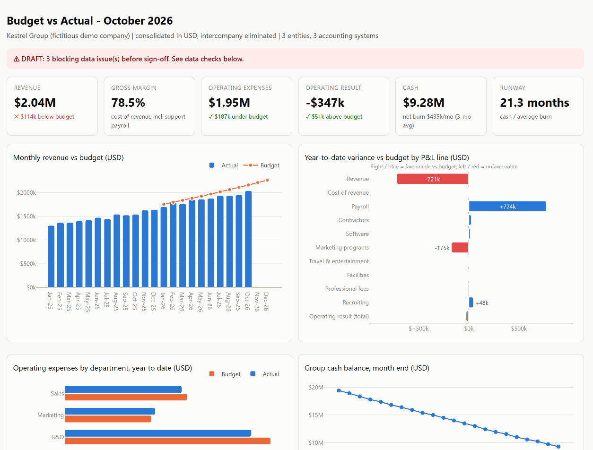

# Budget vs actual dashboard: where the year is beating or missing the plan, in one page

> **Demo on fictitious data** ([dataset notes](../../data/README.md)). The dashboard is generated by the same
> engine as the [month-end pack](../01-month-end-reporting-automation/README.md).



## The problem

The budget lives in an Excel workbook built by FP&A, in local currencies and with its own line labels.
Actuals live in three accounting systems. Every month someone rebuilds the comparison by hand, and three
questions keep getting fuzzy answers:

- Are we on budget, and **which line, entity and department** explains the gap?
- How much of the gap is **FX**, and how much is the business?
- **How long is the runway** at the current burn?

## The solution

```bash
python -m findata.dashboard --period 2026-10
```

- **One self-contained HTML page** ([`dashboard.html`](../../output/2026-10/dashboard.html)) that a CFO
  opens from an email or a link. Nothing to install, nothing to license.
- **KPI tiles:** revenue, gross margin, opex, operating result, cash, burn and runway, each against budget
  in words ("USD 114k below budget"), not just in colour.
- **Four charts:**
  - monthly revenue vs budget;
  - year-to-date variance by P&L line (favourable to the right, unfavourable to the left);
  - opex by department vs budget;
  - cash balance.
- **Variance commentary, P&L table and data checks** on the same page, so nobody reads a number without
  knowing whether it is final.
- **BI-ready tables** in [`dashboard_data/`](../../output/2026-10/dashboard_data/) (`budget_vs_actual.csv`,
  `pl_monthly_actuals.csv`, `cash_balance.csv`). The same tables can feed a **Looker Studio**
  dashboard connected to the client's data.

## The result

| | Before: typical manual process (estimate) | After: generated with the close (demo data) |
|---|---|---|
| Monthly budget vs actual | about 1 day rebuilding pivots | regenerated in seconds with the close |
| FX vs operational variance | mixed together | budget restated at actual rates; FX effect shown separately |
| Departmental view | distorted by mis-tagged costs | untagged cost shown as "Unallocated" and flagged |
| Runway | separate spreadsheet | on the same page: 21.3 months at a 3-month average burn |
| Delivery | a file attachment | a link, plus tables ready for the client's BI tool |

What the October page shows at a glance:
- Revenue is **USD 114k (5.3%) below budget**, driven by US subscriptions after a May churn.
- Year to date, payroll is **USD 774k under budget** (hiring behind plan), which offsets most of the revenue miss.
- Marketing is **USD 175k over budget** year to date, driven by an unbudgeted conference in June.

## Design choices

- **Diverging bars instead of a waterfall.** With an operating loss of USD 4.5M year to date, a waterfall
  would shrink every variance to a sliver next to the totals. The diverging chart puts only the variances
  on the axis.
- **Colourblind-safe palette.** Actual in blue, budget in orange, favourable and unfavourable as a
  blue/red pair rather than green/red. Text labels carry the meaning, so colour is never the only cue.
- **The tool is a detail.** The engine computes every number and writes a ready table. Whether the
  client views it in this page or in Looker Studio changes only the last step.

Code: [`findata/dashboard.py`](../../findata/dashboard.py)
