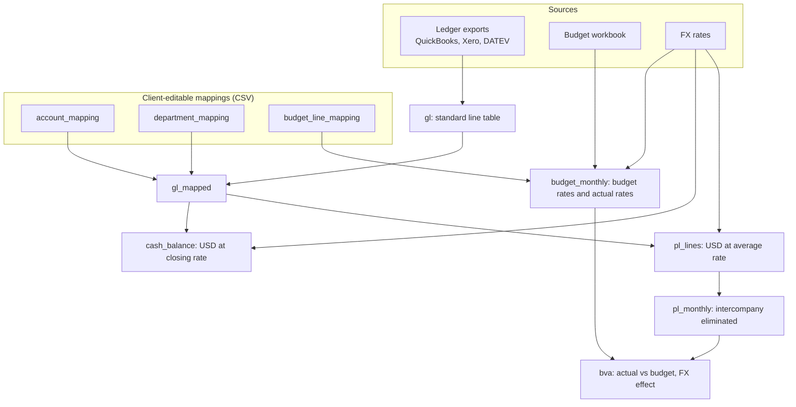

# Finance data foundation: one trusted model for ledger, budget and actuals across entities

> **Demo on fictitious data** ([dataset notes](../../data/README.md)). This is the model underneath
> [case 01](../01-month-end-reporting-automation/README.md) and [case 02](../02-budget-vs-actual-dashboard/README.md).

## The problem

A growing group ends up with one chart of accounts per entity, one currency per entity, department tags
spelled three different ways, intercompany recharges that inflate both revenue and cost, and a budget
built with labels nobody in accounting uses. Every report rebuilds the same joins in a different
spreadsheet, so two reports rarely agree.

## The solution

A single model, in plain SQL, that every report reads from.



| Layer | Object | What it guarantees |
|---|---|---|
| Standard | `gl` | Every source becomes the same columns, one row per debit/credit line, with file and line number kept for traceability |
| Mapped | `gl_mapped` | Group account, account type, statement line and group department on every line; anything unmapped is visible, never dropped silently |
| Currency | `pl_lines`, `cash_balance` | P&L at the monthly average rate, balances at the month-end rate |
| Consolidated | `pl_monthly` | Intercompany revenue and expense eliminated; profit-signed amounts |
| Plan | `budget_monthly` | Budget mapped to the same accounts and departments, at budget rates *and* actual rates |
| Comparison | `bva` | Actual, budget, variance and FX effect at entity × month × account × department |

The model lives in one file, [`findata/sql/model.sql`](../../findata/sql/model.sql). It runs on DuckDB
locally, and the same SQL patterns port to BigQuery, Snowflake or Postgres when a client has a warehouse.

## The result

| | Before | After |
|---|---|---|
| Charts of accounts | 3 local charts, mapped in each report | 1 group chart; mapping in a CSV the finance team edits |
| Currencies | converted ad hoc, rates differ between reports | one rule: P&L at average, cash at closing, budget at budget and actual rates |
| Intercompany | inflates revenue and cost | eliminated in one view, with a mismatch check |
| Trust | "why don't these two reports agree?" | 11 automated tests, including: budget-vs-actual reconciles to its inputs to the cent, no intercompany left in the consolidated P&L, every seeded data issue is detected |
| Adding an entity | a new spreadsheet | a reader (if it is a new system) plus mapping rows |

```bash
pytest   # 11 passed
```

Tests: [`tests/`](../../tests/)
