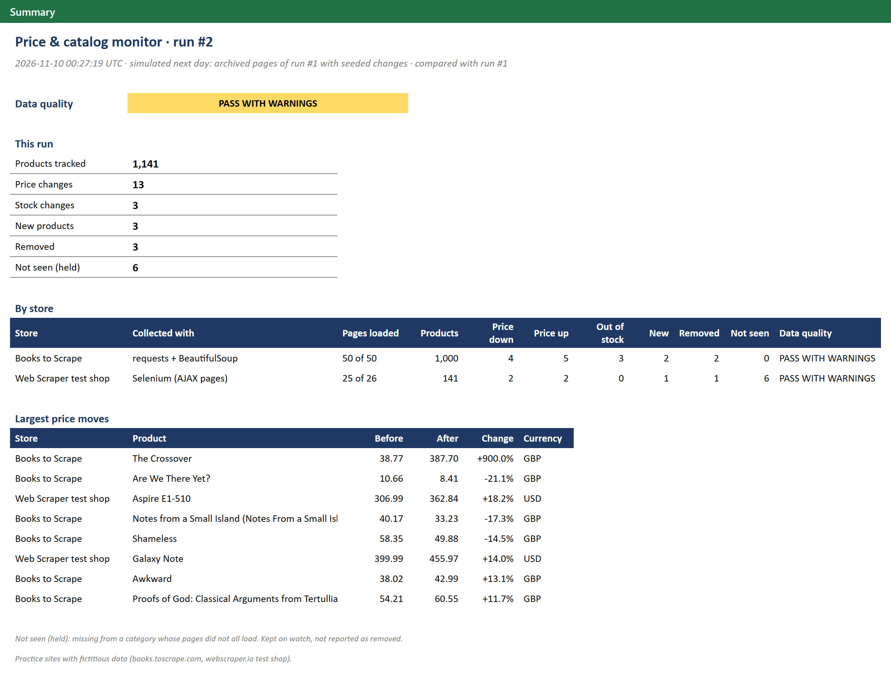
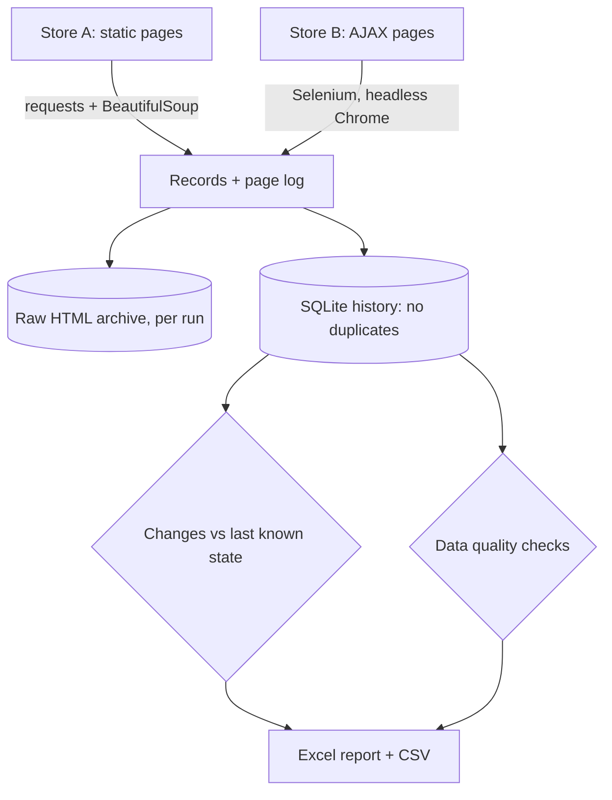
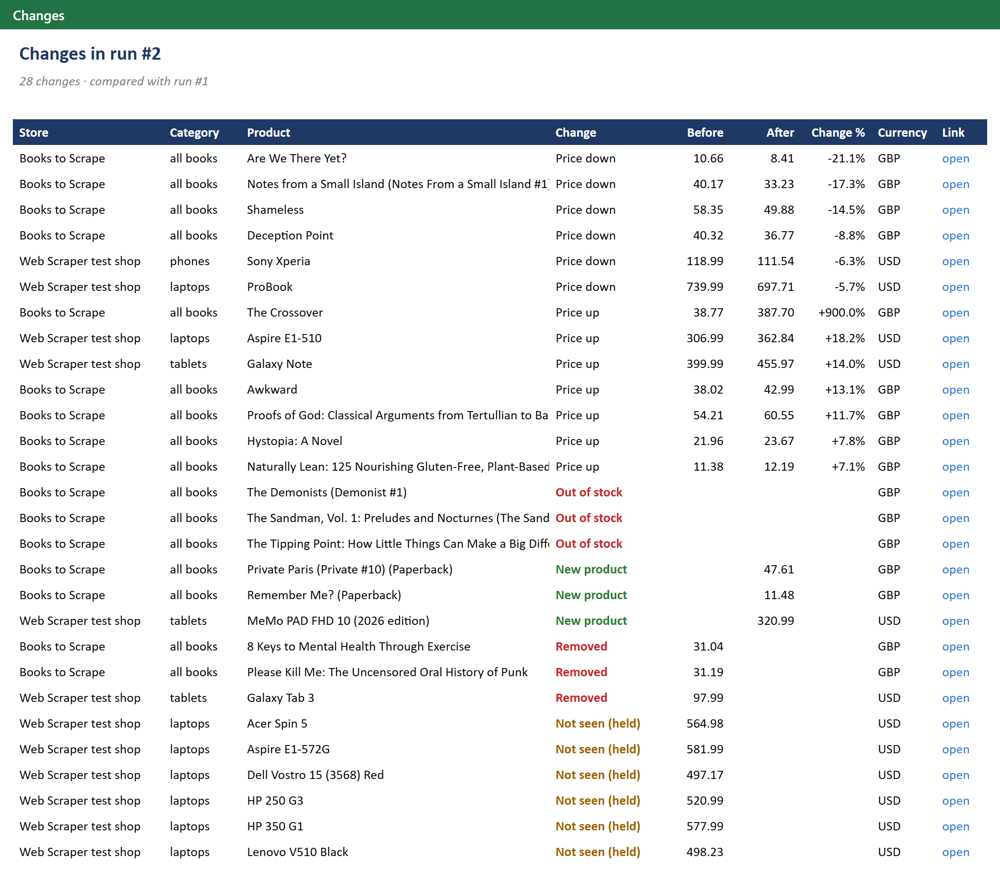
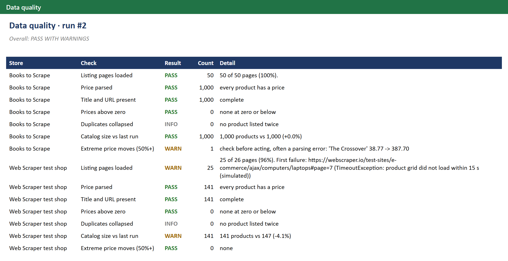

# Price and catalog monitor: two web stores, one recurring pipeline that reports what changed

> **Demo on scraping practice sites.** Both sources are sandboxes built for people to practise web
> scraping, with fictitious products: [Books to Scrape](https://books.toscrape.com/) and the
> [Web Scraper e-commerce test shop](https://webscraper.io/test-sites/e-commerce/ajax). They never change,
> so the second run of the demo is simulated ([how](#how-the-demo-works)).



## The problem

A retailer wants to know every morning what changed in the catalogs it watches: which prices moved, what
went out of stock, what is new and what was delisted. It usually starts with a one-off script that scrapes
once and writes a CSV. Run it every day and the problems show up:

- running it twice appends the same products again;
- a listing page that times out silently drops 20 products, which the next comparison reports as "discontinued";
- a price parsed wrong (a misplaced decimal) goes straight into a repricing decision;
- pages built with JavaScript come back empty, because the products load after the HTML arrives;
- nobody can say whether today's file is complete.

## The solution

One command per run, from the first request to the report:

```bash
python -m pricewatch.run
```



1. **Collect politely.** The crawler reads `robots.txt` first: the Web Scraper site disallows some of its
   test paths, so the crawler never requests them. It sends a generic user agent, pauses 1 second between
   requests and retries timeouts, `429` and `5xx` with a growing wait. A `404` is not retried.
2. **Use the right tool for each page.** The bookstore serves plain HTML, so `requests` and BeautifulSoup
   are enough. The crawler reads the page count on page 1 and plans every page up front, so a failed page
   costs 20 products, not the rest of the crawl. The electronics shop paginates with AJAX: the URL never
   changes, so a plain HTTP request only ever sees page 1. Selenium clicks through the pager the way a
   visitor would and waits for the product grid to be replaced each time. It does not touch the site's
   cookie banner: consent is not accepted on anyone's behalf.
3. **Keep the evidence.** Every listing page is logged as loaded or failed, with the error. The raw HTML
   is archived per run (gzipped), so a parser fix can be replayed on past runs without asking the site
   again (`--replay`). Every record keeps the page it came from.
4. **Store without duplicates.** SQLite with primary keys (one row per product, one observation per
   product per run) and upserts. Processing the same run twice leaves the database exactly as processing
   it once. A product listed twice in one run is kept once and counted.
5. **Detect what changed** against the last known state of each product: price down or up (prices are
   stored in integer cents, so floating-point noise never looks like a change), out of stock or back in
   stock, new, listed again, removed. A missing product counts as **removed** only when every listing
   page of its category loaded. If a page failed, it is held as **not seen** and reported as such. After
   3 misses in a row it counts as removed anyway.
6. **Check quality before anyone acts:** pages loaded, prices parsed, titles and URLs present, prices
   above zero, duplicates, catalog size against the last run, and price moves of 50% or more, which are
   more often a parsing error than a real price.
7. **Report.** An Excel workbook (summary, changes, catalog, data quality, run history) for people, and CSV
   files (`changes`, `catalog`, `quality`) for the next tool, such as a Looker Studio dashboard or a
   repricing script.

## The result

| | Before: one-off script | After: this pipeline (measured on the demo) |
|---|---|---|
| Collection | one script per site, run by hand | **1,147 products from 76 pages in 82 seconds**, both stores, with a 1-second pause between requests |
| Running it again | duplicates appended | **same database**; every run kept in the history |
| Page that fails to load | 20 products silently missing, "discontinued" tomorrow | **logged with its error**; its 6 products held as *not seen*, **0 false removals** |
| JavaScript pages | empty, or page 1 only | **every AJAX page**, through Selenium |
| Price changes | two CSV files compared by hand | before, after and % for every product |
| Misplaced decimal | goes into the decision | **flagged for review** before anyone acts |
| "Is today's file complete?" | nobody knows | "76 of 76 pages loaded", with PASS / WARN / FAIL per store |
| Seeded changes in the simulated run | n/a | **28 of 28 detected**, and nothing else |

| Changes | Data quality |
|---|---|
|  |  |

Sample output: [`Price_Monitor_Report.xlsx`](../../output/pricewatch/Price_Monitor_Report.xlsx) ·
[`changes.csv`](../../output/pricewatch/changes.csv) · [`catalog.csv`](../../output/pricewatch/catalog.csv)

## How the demo works

```bash
python -m pricewatch.demo
```

- **Run 1** is a real crawl of both practice stores. It is the baseline: on a first run every product is
  "new", which says nothing, so no changes are reported.
- **Run 2** is a simulated next day. The practice sites never change, so the demo replays the archived
  pages of run 1 and seeds changes into them: 13 price moves (one of them a misplaced decimal), 3 stock-outs, 3 delisted products, 3 new arrivals and one laptop listing page that times out, hiding 6 products. The seeded list lives in
  [`simulate.py`](../../pricewatch/simulate.py), and a test checks that the detector finds every seeded
  change and nothing else.

To run it on a schedule, point cron (or Windows Task Scheduler) at the single-run command:

```bash
0 7 * * *  cd /path/to/repo && python -m pricewatch.run
```

## Design choices

- **Collection rules come first.** Public pages only, no logins, no CAPTCHA bypass, no personal data,
  and never a site whose terms forbid collection. `robots.txt` and a pause between requests are the
  default, not an option.
- **The lightest tool that works.** If a site has a JSON endpoint behind its pages, reading it is faster
  and gentler than a browser. Selenium is for pages that only exist after JavaScript runs.
- **Completeness is data.** The page log is what lets the report say "the catalog is complete" or "these
  6 products could not be checked today". Without it, a timeout and a delisting look the same.
- **One file, no server.** SQLite keeps the whole history in one file. For a client, the same tables can
  live in Postgres or BigQuery without changing the logic.
- **Adding a store** is a configuration entry plus a parser function, tested on saved HTML.

Code: [`fetch.py`](../../pricewatch/fetch.py) · [`collect.py`](../../pricewatch/collect.py) ·
[`parse.py`](../../pricewatch/parse.py) · [`store.py`](../../pricewatch/store.py) ·
[`changes.py`](../../pricewatch/changes.py) · [`quality.py`](../../pricewatch/quality.py) ·
[`report.py`](../../pricewatch/report.py)
