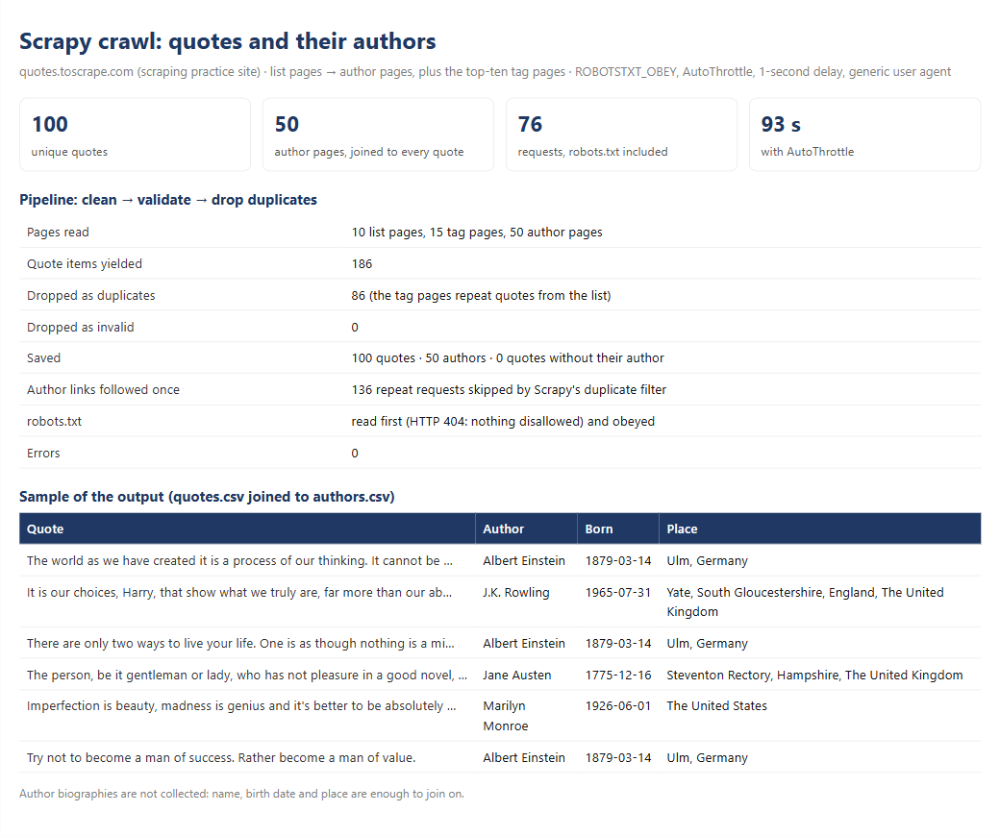

# Scrapy spider: from a paginated list to the detail pages, validated and without duplicates

> **Demo on a scraping practice site.** The source is [Quotes to Scrape](https://quotes.toscrape.com/), a
> sandbox built for people to practise web scraping. Author biographies are not collected: name, birth
> date and place are enough to join on.



| | |
|---|---|
| **Task** | Collect every quote with its tags, plus each author's details, which live on a separate page. Follow the pagination, reach the same quotes through the tag pages too, and deliver one clean row per quote and per author, without hammering the site. |
| **Solution** | Scrapy spider (list → author pages, plus the top-ten tag pages) · item pipelines that clean, validate and drop duplicates · `ROBOTSTXT_OBEY`, AutoThrottle, 1-second delay, generic user agent · one CSV feed per item type and a run summary |
| **Records** | **100 unique quotes and 50 authors**, from 186 quote items (86 duplicates dropped, 0 invalid); every quote joins to its author |
| **Time** | **93 seconds** for 76 requests, at the pace AutoThrottle allows |

## How it works

1. **The spider** starts on the home page, reads the 10 quotes on each list page and follows the pager. Each
   quote links to its author's page, and the spider follows those links too. From the home page it also
   follows the ten "top tags", whose pages list quotes the main list already has. Requesting the canonical
   author URL (with the trailing slash) saves a redirect per author.
2. **Scrapy's duplicate filter** requests each page once, however many quotes link to it: 136 repeat
   requests were skipped, so 50 authors cost 50 requests.
3. **Item pipelines**, in order:
   - **clean:** collapse spaces, strip the curly quotes, turn "March 14, 1879" into `1879-03-14`;
   - **validate:** a quote needs its text, author and author link; an author needs a name and a real date;
     anything else is dropped and counted by reason;
   - **drop duplicates:** a quote's key is a hash of its normalized text and author, so the same quote seen
     on a tag page, or with different spacing, is kept once.
4. **Politeness is configuration**, not a promise: `ROBOTSTXT_OBEY = True` (the site publishes no
   robots.txt, which the spider reads as "nothing disallowed"), AutoThrottle on, at least 1 second between
   requests, at most 2 at a time, and a generic user agent.
5. **Feeds:** `quotes.csv` and `authors.csv`, one per item type, plus `run_summary.json` with the numbers
   below, read from Scrapy's own stats.

## The run, measured

| | |
|---|---|
| Pages read | 10 list pages, 15 tag pages, 50 author pages, plus robots.txt: 76 requests, 0 errors |
| Quote items yielded | 186 |
| Dropped as duplicates | 86 (every quote on a tag page was already on the list) |
| Dropped as invalid | 0 |
| Saved | 100 quotes, 50 authors, 0 quotes without their author |
| Elapsed | 92.7 seconds |

Output: [`quotes.csv`](output/quotes.csv) · [`authors.csv`](output/authors.csv) ·
[`run_summary.json`](output/run_summary.json) · [`summary.html`](output/summary.html)

## Run it

```bash
cd minicases/01-scrapy-quotes
python -m quotes_crawler.run   # the crawl plus the summary (or: scrapy crawl quotes)
pytest                         # 7 tests, offline, on saved pages
```

## Why Scrapy here

For 76 pages, requests and BeautifulSoup would do. Scrapy earns its place when the same job grows to
thousands of pages: concurrency with a per-site limit, retries, the duplicate filter, AutoThrottle,
pipelines and feeds come built in, and the spider stays a short file of selectors.

Code: [`quotes.py`](quotes_crawler/spiders/quotes.py) · [`pipelines.py`](quotes_crawler/pipelines.py) ·
[`settings.py`](quotes_crawler/settings.py) · [`run.py`](quotes_crawler/run.py)
