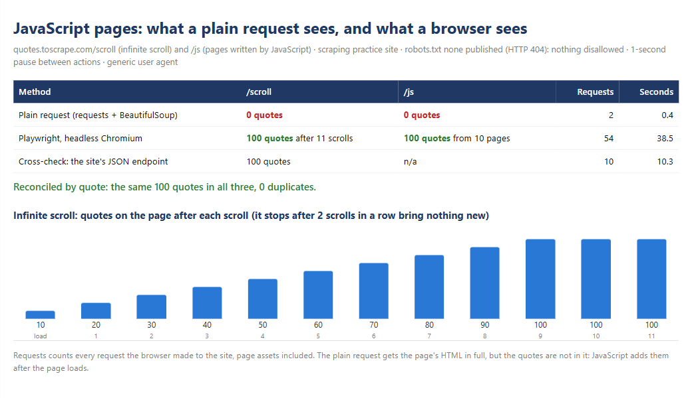

# Playwright for JavaScript pages: infinite scroll read to the end, where a plain request sees nothing

> **Demo on a scraping practice site.** The source is [Quotes to Scrape](https://quotes.toscrape.com/), a
> sandbox built for people to practise web scraping. Its `/scroll` page loads quotes as you scroll, and its
> `/js` pages write the quotes with JavaScript.



| | |
|---|---|
| **Task** | Collect every item from pages built by JavaScript: an infinite-scroll feed and a paginated listing rendered in the browser. Prove the result is complete. |
| **Solution** | Playwright for Python driving headless Chromium: scroll until two scrolls in a row bring nothing new, render each page and follow "Next" · the same pages fetched with a plain request for comparison · result reconciled quote by quote against the site's own JSON endpoint |
| **Records** | **100 of 100 quotes** from the infinite scroll and **100 of 100** from the 10 JavaScript pages; the plain request found **0** on both |
| **Time** | Infinite scroll in **26 seconds** (11 scrolls, 1-second pause, 5-second wait for new items) · 10 JavaScript pages in **12 seconds** |

## What a plain request sees

A one-off script with requests and BeautifulSoup gets the full HTML of both pages, and **0 quotes**. The
quotes are not in the HTML: on `/scroll` a script asks the server for them after the page loads, 10 at a
time, as the visitor reaches the bottom; on `/js` a script writes them into the page. Nothing fails, and
the CSV comes out empty or short. That silent failure is the risk.

## What the browser does

1. **Infinite scroll.** Playwright opens the page in headless Chromium, waits for the first quotes, then
   scrolls to the bottom and waits up to 5 seconds for the count to grow. It stops when two scrolls in a row
   bring nothing new, so a slow answer does not end the crawl early, and it does not scroll forever either.
   Measured: 10, 20, 30... 100 quotes, then two empty scrolls, then stop.
2. **JavaScript pages.** It renders each page, reads the quotes once they exist and follows the "Next" link
   until there is none: 10 pages.
3. **Politely.** robots.txt first (the site publishes none, so nothing is disallowed), a generic user
   agent, and at least 1 second between actions that make the page request something.

## Proof that nothing is missing

| Method | `/scroll` | `/js` | Requests | Seconds |
|---|---|---|---|---|
| Plain request (requests + BeautifulSoup) | 0 quotes | 0 quotes | 2 | 0.4 |
| Playwright, headless Chromium | 100 quotes after 11 scrolls | 100 quotes from 10 pages | 54 | 38.5 |
| Cross-check: the site's JSON endpoint | 100 quotes | n/a | 10 | 10.3 |

The three results hold **the same 100 quotes**, compared by a key built from each quote's text and author,
with 0 duplicates. The browser's request count includes page assets (scripts and stylesheets).

Output: [`scroll_quotes.csv`](output/scroll_quotes.csv) · [`js_quotes.csv`](output/js_quotes.csv) ·
[`run_summary.json`](output/run_summary.json) · [`summary.html`](output/summary.html)

## The lightest tool that works

The scroll page gets its data from a JSON endpoint (`/api/quotes?page=N`). When an endpoint like that exists
and its use is allowed, reading it is faster and gentler than a browser: 10 requests instead of 14, no
Chromium. Here it serves as the cross-check. The browser is for pages that only exist after JavaScript runs
and have no usable endpoint behind them.

## Run it

```bash
cd minicases/02-playwright-js-pages
python -m playwright install chromium   # once
python -m jsquotes.run                  # the comparison above
pytest                                  # 5 tests, offline: real Chromium on fake pages
```

The tests serve fake pages through Playwright's router, including a feed that stops after 4 batches, and
check that the scroll loop stops after two empty scrolls and never asks for a batch past the last one.

Code: [`collect.py`](jsquotes/collect.py) · [`run.py`](jsquotes/run.py)
