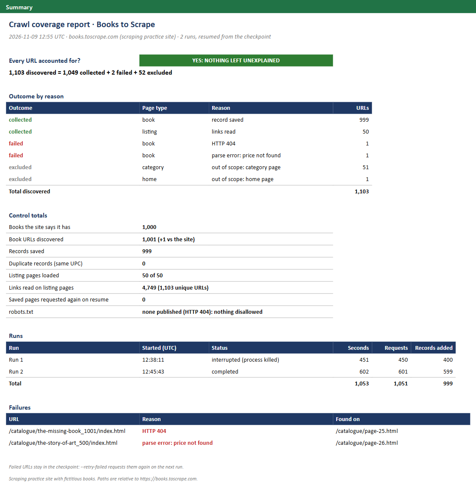

# Crawl coverage report: every discovered URL accounted for, with checkpoint and resume

> **Demo on a scraping practice site.** The source is [Books to Scrape](https://books.toscrape.com/), a
> sandbox built for people to practise web scraping, with 1,000 fictitious books. Two failures are injected
> on purpose, so the report has something real to catch.



| | |
|---|---|
| **Task** | Collect all 1,000 book pages and prove it: every URL the crawler discovers must end as collected, failed with a reason, or excluded by a rule, with no silent omissions. The crawl must survive being stopped halfway without losing or duplicating records. |
| **Solution** | requests and BeautifulSoup · SQLite checkpoint, one transaction per page · a coverage report that reconciles to zero, with control totals against the site's own count · robots.txt, 1-second pause, generic user agent |
| **Records** | **1,103 URLs, every one accounted for:** 1,049 collected (999 books and 50 listing pages), 2 failed (the 2 injected), 52 excluded · 999 records, 0 duplicates |
| **Time** | **17.5 minutes** for 1,051 requests at 1 per second, across a run killed after 400 books and the run that resumed it |

## How it works

1. **Discover.** The crawler reads listing page 1, learns from the pager that there are 50, and plans all of
   them up front, so a listing page that fails hides 20 books, not the rest of the catalog. Every link on
   every listing page is normalized and recorded once, with the page that linked to it.
2. **Classify every URL.** A book page is collected. A listing page is read for its links. A category page
   or the home page is excluded by a scope rule, and the rule is written next to it. Nothing is dropped
   without a line in the report.
3. **Collect politely.** robots.txt first (the site publishes none, so nothing is disallowed), a generic
   user agent, at least 1 second between requests, retries for timeouts, `429` and `5xx`, and no retry
   for a `404`.
4. **Validate each record.** Title, price and UPC must be present and the price above zero. A page that
   loads but breaks the template is a failure with its reason, not a row with blank fields. A second URL
   for a book already saved (same UPC) is a failure too, so the dataset keeps one row per book.
5. **Checkpoint.** One SQLite file holds every URL, its outcome, every record and every run. Each page is
   finished in a single transaction: its outcome, its record, the request log and the run counters. Kill
   the process at any moment and every page is either fully done or still pending. The next run picks up
   the pending ones and never requests a saved page again.
6. **Report.** An Excel workbook (summary, one row per URL, records) and two CSV files. The summary only says
   "nothing left unexplained" when discovered = collected + failed + excluded and nothing is pending.

## The demo, measured

```bash
python -m crawlcheck.demo
```

The demo starts from nothing, with the two failures injected: a broken link (as if listing page 25 linked
to a book that no longer exists; the site answers `404`) and a template change on one book page (its price
block removed before parsing). When 400 books are saved, it kills the process, with no clean shutdown, as a
crash or a closed laptop would. Then it runs again.

| Run | What happened | Seconds | Requests | Records added |
|---|---|---|---|---|
| 1 | killed when 400 books were saved | 451 | 450 | 400 |
| 2 | resumed from the checkpoint: 502 URLs done, 601 pending | 602 | 601 | 599 |
| **Total** | | **1,053** | **1,051** | **999** |

| Control | Result |
|---|---|
| Every URL accounted for | 1,103 discovered = 1,049 collected + 2 failed + 52 excluded, 0 pending |
| Books the site says it has | 1,000 |
| Book URLs discovered | 1,001: the 1,000 plus the injected dead link |
| Records saved | 999: every book except the one with the broken template |
| Duplicate records (same UPC) | 0 |
| Listing pages loaded | 50 of 50 |
| Saved pages requested again after the restart | 0 |
| Links read on listing pages | 4,749, pointing to 1,103 unique URLs |

The two failures are the two injected ones, each with its reason and the page that linked to it.
`--retry-failed` puts them back in the queue on the next run.

Output: [`coverage_report.xlsx`](output/coverage_report.xlsx) · [`coverage.csv`](output/coverage.csv) (one row
per URL) · [`books.csv`](output/books.csv)

## Run it

```bash
cd minicases/03-coverage-report
python -m crawlcheck.run          # start, or resume where the last run stopped
python -m crawlcheck.demo         # the demo above, about 18 minutes at 1 request per second
pytest                            # 10 tests, offline
```

## Design choices

- **Completeness is data.** A page that times out and a book that does not exist look the same in a CSV:
  both are missing. The coverage table is what tells them apart.
- **Control totals, as in accounting.** The site says it has 1,000 books; the report compares that with
  the book URLs discovered and the records saved, and explains the difference.
- **Rollback journal, not WAL.** The first version used SQLite's WAL mode. After the kill, its shared-memory
  file sat in a cloud-synced folder and the restart could not open the database. The default journal is
  just as crash-safe and leaves no extra file behind for a sync client to lock.

Code: [`crawl.py`](crawlcheck/crawl.py) · [`state.py`](crawlcheck/state.py) · [`parse.py`](crawlcheck/parse.py) ·
[`polite.py`](crawlcheck/polite.py) · [`report.py`](crawlcheck/report.py)
