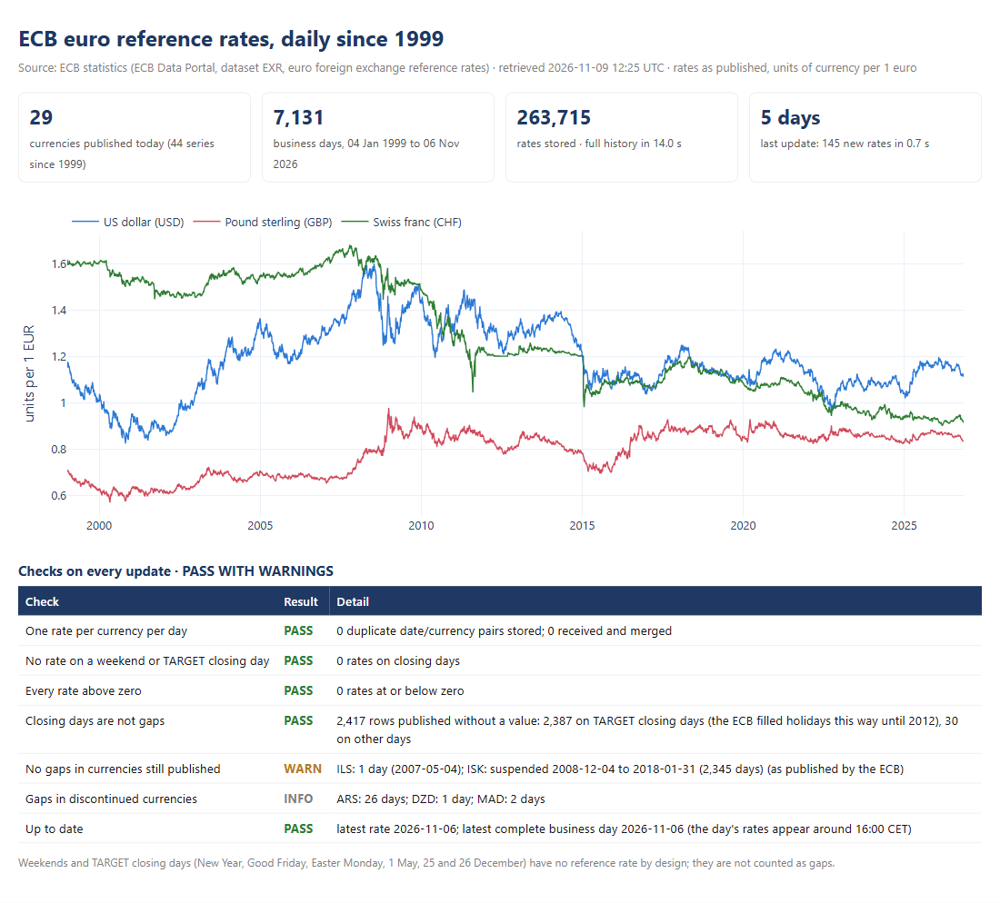

# ECB exchange rates: daily reference rates since 1999 from the official API, updated incrementally

> **Official public API.** The data comes from the European Central Bank's
> [Data Portal](https://data.ecb.europa.eu/) (dataset EXR), read through its public API, which needs no key.
> Source: ECB statistics. The ECB allows free reuse, commercial use included, when the source is quoted
> and the statistics are not modified
> ([usage policy](https://www.ecb.europa.eu/stats/ecb_statistics/governance_and_quality_framework/html/usage_policy.en.html)).
> Every rate here is as published.



| | |
|---|---|
| **Task** | Keep a complete history of the ECB's daily euro reference rates for finance work (revaluation, invoices in other currencies, budget rates). Update it every day without downloading everything again, and prove that nothing is missing. |
| **Solution** | Python and requests on the ECB's SDMX API · history in SQLite, updated incrementally · TARGET holiday calendar · checks for gaps, duplicates and freshness · CSV, Excel with a chart, HTML page |
| **Records** | **263,715 rates**: 44 currency series (29 still published), 7,131 business days from 4 Jan 1999 to 6 Nov 2026 |
| **Time** | Full history in **14 seconds** (one request) · daily update in **0.7 seconds** |

## How it works

1. **One function.** `fetch_rates(["USD", "GBP"], start="2026-01-01")` returns a tidy table (date, currency,
   rate). It retries when the portal is busy (it sometimes answers 503 or 504: one came up while this was
   built) and never reads an HTML error page as data.
2. **Incremental update.** The local history knows its last day, and the next run asks the API only from
   that day on. The last stored day is read again as an overlap check: if the ECB ever revised a rate, the
   change is logged, not silently overwritten.
3. **Holidays are not gaps.** There is no rate on weekends and TARGET closing days: New Year's Day, Good
   Friday, Easter Monday, 1 May, 25 and 26 December, plus two one-off closings on 31 December 1999 and 2001.
   The source is not consistent about them: until 2012 the ECB published closing days as rows without a
   value (2,387 of them), and since then the rows are simply absent. Both are handled the same way.
4. **Checks on every run:** one rate per currency per day, no rate on a closing day, every rate above zero,
   no missing business day inside a currency's active range, data up to date.

The demo measures the three cases: a full load into an empty history, a second run straight after (it
receives the last day again and adds nothing), and a run after deleting the last 5 days from the local
history, as if the previous run had been a week ago:

| Run | Asked the API from | Rows received | New rates | Unchanged | Revised | Seconds |
|---|---|---|---|---|---|---|
| Full history | 1999 | 266,132 | 263,715 | 0 | 0 | 14.0 |
| Again, straight after | 6 Nov 2026 | 29 | 0 | 29 | 0 | 0.7 |
| A week behind | 30 Oct 2026 | 174 | 145 (5 days) | 29 | 0 | 0.7 |

## What the checks found in the real data

| Check | Result |
|---|---|
| Duplicate date and currency pairs | 0 |
| Rates on a weekend or closing day | 0 |
| Rows published without a value | 2,417: 2,387 on closing days, 30 on business days |
| Missing days in currencies still published | **ISK suspended from 4 Dec 2008 to 31 Jan 2018** (2,345 business days); ILS missing on 4 May 2007 |
| Discontinued series | 15, such as GRD (euro since 2001), BGN (euro since 2026), RUB (suspended in March 2022) |

These gaps are in the ECB's own data. The report shows them instead of filling them in: a model that
carries the 2008 krona rate across nine years should know it is doing so.

## Deliverables

- [`ecb_fx_rates.xlsx`](output/ecb_fx_rates.xlsx): checks, update log, coverage by currency, every rate
  (one row per day, one column per currency) and a native Excel chart
- [`fx_report.html`](output/fx_report.html): the page in the picture, with an interactive chart
- [`sample_last_30_days.csv`](output/sample_last_30_days.csv). The run also writes the full history as CSV, in
  long and wide format.

## Run it

```bash
cd minicases/04-ecb-fx-rates
python -m ecbfx.update    # first run: the full history; after that, only the new days
python -m ecbfx.demo      # the three runs above
pytest                    # 18 tests, offline
```

The rates for a day appear around 16:00 CET, so a daily schedule (cron, Task Scheduler or GitHub Actions)
can run at 16:30 CET. Other scripts can import the collector: `from ecbfx import fetch_rates`.

Code: [`api.py`](ecbfx/api.py) · [`target.py`](ecbfx/target.py) · [`store.py`](ecbfx/store.py) ·
[`checks.py`](ecbfx/checks.py) · [`report.py`](ecbfx/report.py)
