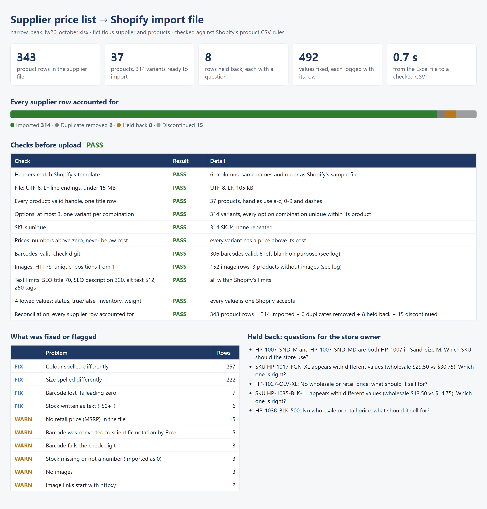
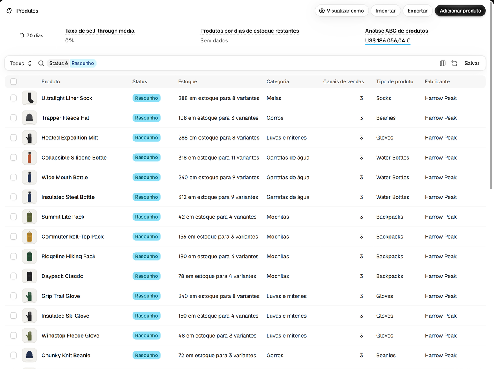

# Supplier price list to Shopify import: every row accounted for, and next month's update in one run

> **Demonstration with fictitious data.** Harrow Peak Wholesale, its products and barcodes are invented. The
> product images are simple illustrations drawn by code ([`art.py`](vendorfeed/art.py)) and served from this
> site. The output follows the column list of Shopify's own sample product CSV and the rules in Shopify's Help
> Center, and both months were imported into a Shopify development store on 13 Nov 2026: products, variants,
> stock, status and prices matched the files (details below).



| | |
|---|---|
| **Task** | A store owner gets the supplier's price list in Excel every month and needs it in Shopify's product CSV: one product per style, colour and size as variants, prices, stock, barcodes and images. Doing it by hand takes hours each time the supplier updates prices. |
| **Solution** | Python and pandas · finds the header under title rows and maps renamed columns · standardises colours, sizes, weights and barcodes · writes Shopify's 61-column format · 11 checks against Shopify's rules before upload · next month: a change report and three update files |
| **Records** | First list: **343 product rows** → **37 products, 314 variants**, 8 rows held back with a question each. Second list: **31 price changes**, 3 new products, 6 new variants, 3 products to archive |
| **Time** | **0.7 seconds** for the first import · **0.9 seconds** for next month's update, change report included |

## How it works

1. **Read the file as it arrives.** The header is found wherever it is (here on row 4, under the supplier's
   name and a note). Title rows, category banners and footer notes are labelled and set aside. Column names are
   matched through a list of aliases, so next month's file can say "SKU" instead of "Item #" and "Retail"
   instead of "MSRP", in a different order, and still read the same.
2. **Clean each field, and log every change with its row number.** "NVY", "navy" and "Navy" become Navy;
   "LG", "lrg" and "Large" become L; "3.2 oz", "1.1 lbs" and "0.38 kg" become grams; "$12.50" becomes 12.50.
   Product titles come from the shared start of the variants' descriptions ("MERINO HIKER SOCK NVY S" →
   Merino Hiker Sock), and handles from the titles.
3. **Never guess where the store owner should decide.** The same SKU twice with different prices, two SKUs for
   the same colour and size, or a row with no price at all is held back, with the question to answer. A
   missing retail price is filled by a markup rule the store owner sets (here wholesale × 2, ending in .99) and
   flagged for confirmation.
4. **Write Shopify's format exactly.** The 61 columns of Shopify's sample file, in the same order and spelling.
   The first row of a product carries the product fields, each variant is a row with the same handle, and
   each extra image is a row of its own. Products arrive as **drafts**, so nothing goes live before review.
   The product category goes in as its Shopify taxonomy ID (`aa-1-18` for socks): the test import rejected the
   English category path and accepted the IDs, which also work whatever language the store admin uses.
5. **Check before upload.** A Shopify import cannot be cancelled or undone, so the file is checked first:

| Check | Result on the first list |
|---|---|
| Headers match Shopify's template | 61 columns, same names and order |
| File: UTF-8, LF line endings, under 15 MB | 105 KB |
| Every product: valid handle, one title row | 37 products |
| Options: at most 3, one variant per combination | 314 variants |
| SKUs unique | 314 SKUs |
| Prices: numbers above zero, never below cost | all |
| Barcodes: valid check digit | 306 valid, 8 left blank on purpose |
| Images: HTTPS, unique, positions from 1 | 152 image rows |
| Text limits (SEO title 70, SEO description 320, alt text 512) | all within |
| Allowed values (status, true/false, inventory, weight unit) | all accepted |
| **Every supplier row accounted for** | **343 = 314 imported + 6 duplicates + 8 held back + 15 discontinued** |

## What the first list had in it

The October file was built with these problems on purpose. The tests check that every one is caught.

| Problem | Rows | What happened |
|---|---|---|
| Colours and sizes spelled several ways | 257 and 222 | Standardised |
| Barcode lost its leading zero in Excel (11 digits) | 7 | Zero restored; check digit confirms it |
| Barcode turned into `8.40123E+11` by Excel | 5 | Left blank: the digits are gone, the supplier has to resend them |
| Barcode fails the check digit | 3 | Left blank, flagged |
| Stock written as "50+", "-" or "N/A" | 9 | 50, or 0 with a flag |
| No retail price for three styles | 15 | Priced by the markup rule, flagged for confirmation |
| Image links on http:// | 2 styles | Left out (Shopify only downloads HTTPS images), flagged |
| Exact duplicate rows | 6 | Removed |
| Same SKU with two wholesale prices | 2 SKUs | Held back: which one is right? |
| Two SKUs for the same colour and size | 1 pair | Held back: which SKU should the store use? |
| No price at all | 2 | Held back |
| Discontinued items | 15 | Left out |

## Next month: the part that repeats

The November list renames and reorders the columns, raises prices on four styles, changes ten single
prices, adds three products and a new colour, and drops three products. Compared SKU by SKU with what was
imported in October:

| Change | Count |
|---|---|
| Price changes | 31 (24 up, 7 down) |
| Cost up, retail unchanged: the margin falls | 8 |
| Stock changes | 263 |
| New products | 3 |
| New variants of existing products | 6 (a new colour, plus the 3 rows held back in October, now resolved) |
| Products to archive | 3 |

Three files come out, each meant for Shopify's import with **"Overwrite products with matching handles"**:

- `new_products.csv`: the new products in full, as drafts
- `update_existing.csv`: only the columns that change (price, cost, stock, barcode) plus what Shopify needs
  to find each variant. Shopify leaves the columns that are not in the file untouched, so descriptions and
  photos edited in the store stay as they are. Every variant of a changed product is listed. New variants
  arrive without a photo, and the change report lists them.
- `archive.csv`: products the supplier no longer sells, set to archived instead of deleted, so order history
  keeps them

## Tested in a real Shopify store

Both months were imported into a Shopify development store, and the store was compared with the files:

| Step | What the store showed |
|---|---|
| October import | 37 products as drafts, 314 variants, 152 images; stock and variant count matched for all 37 |
| November: new products | 3 products, 19 variants |
| November: update | Prices changed (one hoodie from $64.99 to $70.99), 6 new variants added, stock matched for all 40 products, descriptions and photos untouched |
| November: archive | 3 products archived, their variants kept |

The test import also caught three things the documentation does not say, now handled in the code:

1. The product category written as an English path was rejected; the taxonomy ID is accepted.
2. A variant image is refused unless the image itself is in the same file, so the update file has no image
   columns (adding the product images would replace the store's photos).
3. Changing only the status still needs every variant's options, so `archive.csv` lists them.



## Deliverables

- [`shopify_products.csv`](output/october/shopify_products.csv): the import file
- [`import_report.xlsx`](output/october/import_report.xlsx): checks, questions for the store owner, every fix
  with its row, the product list, and the fate of every supplier row
- [`import_report.html`](output/october/import_report.html): the page in the picture
- November: [`changes_report.xlsx`](output/november/changes_report.xlsx),
  [`new_products.csv`](output/november/new_products.csv), [`update_existing.csv`](output/november/update_existing.csv),
  [`archive.csv`](output/november/archive.csv)
- The two supplier files: [`october`](input/harrow_peak_fw26_october.xlsx), [`november`](input/harrow_peak_fw26_november.xlsx)

## Run it

```bash
cd minicases/06-supplier-file-to-shopify
python -m vendorfeed.demo        # builds both supplier files and runs both months
python -m vendorfeed.art         # draws the product illustrations the files link to
python -m vendorfeed.run input/harrow_peak_fw26_october.xlsx --out output/october
python -m vendorfeed.run input/harrow_peak_fw26_november.xlsx --out output/november --previous output/october
pytest                           # 14 tests, offline
```

A new supplier usually means a few lines in [`config.py`](vendorfeed/config.py): column aliases, category
mapping, colour and size spellings, markup rule and default status. The code stays the same.

Code: [`read.py`](vendorfeed/read.py) · [`clean.py`](vendorfeed/clean.py) · [`shopify.py`](vendorfeed/shopify.py) ·
[`checks.py`](vendorfeed/checks.py) · [`diff.py`](vendorfeed/diff.py) · [`report.py`](vendorfeed/report.py)
